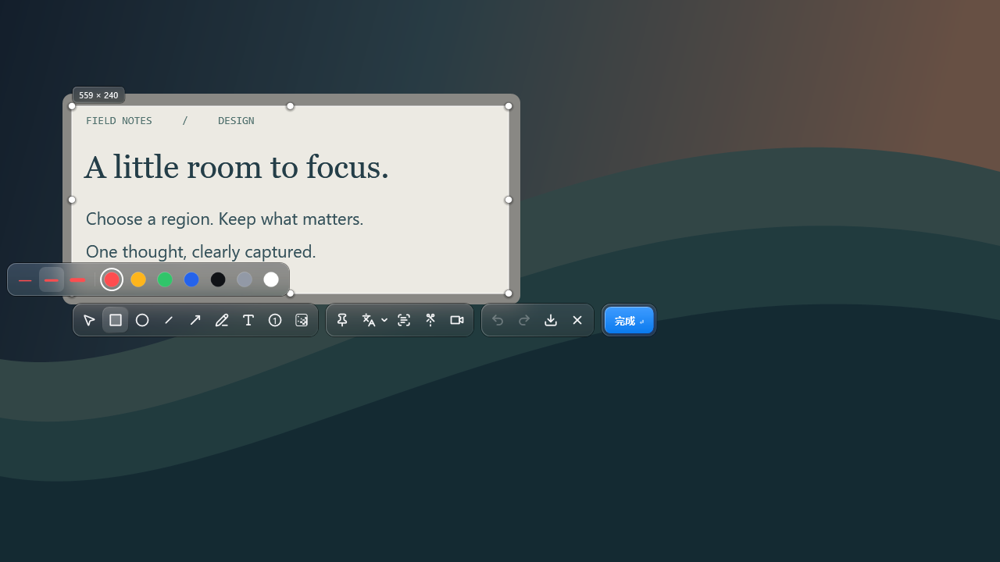
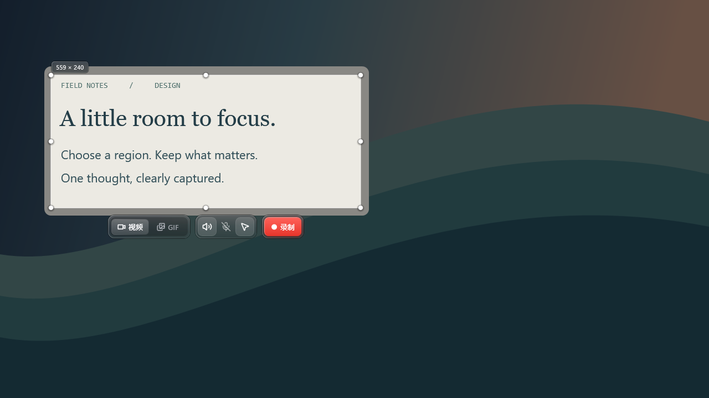

# Screen

个人使用的 Windows 截图、录屏、OCR 与翻译工具，使用 .NET 10 / WPF。

程序、托盘与安装器使用统一的蓝色截图图标。当前分支采用中性深色玻璃主题：截图工具栏从截取画面取样磨砂，完成操作用蓝色，录制用红色。

## 下载

**[获取最新稳定版](https://github.com/Fahaxiki123/Screen/releases/latest)** · [全部版本](https://github.com/Fahaxiki123/Screen/releases)

下列安装包和校验文件对应已发布的 **v1.0.16**。本页介绍的玻璃界面和 GIF 导出在 `ui/v4-glass` 分支，未包含在这个旧安装包中；可检出本分支后按下文构建。

**[下载 1.0.16 Windows x64 安装包](https://github.com/Fahaxiki123/Screen/releases/download/v1.0.16/Screen-1.0.16-win-x64-Setup.exe)** · [版本说明](https://github.com/Fahaxiki123/Screen/releases/tag/v1.0.16) · [SHA-256 校验文件](https://github.com/Fahaxiki123/Screen/releases/download/v1.0.16/SHA256SUMS.txt) · [同版本源码](https://github.com/Fahaxiki123/Screen/tree/v1.0.16)

安装器允许在 Windows 10 21H2（19044）及更新版本的 Windows 10 / Windows 11 x64 上安装，包含 .NET Desktop Runtime、OCR 模型、FFmpeg 和 Visual C++ 运行库。Windows 10 实机安装与运行待验收。更新前请完成截图或录屏并退出 Screen。

### 1.0.16 更新

- 英文界面短句和长段落可以自动识别并交给 MyMemory 翻译。源语言不确定时仍可手选。
- 录屏临时目录支持 UNC 共享路径，空间检查按当前用户在所选目录的可用容量计算。
- 在支持 AVX2 的 CPU 上加速 GDI 回退画面的 NV12 颜色转换，适用于 4K 录屏。光标单独合成，支持显示或隐藏。

- 录屏通过带逐帧采集时间戳的视频输入保留真实时长；编码变慢时降低实际采集频率，避免视频加速及音频尾部被截断。预览按独立固定帧率解码；裁切按本次录制目标帧率重编码并保持画面与声音的时间关系，端点精度为一个视频帧以内。
- 音频设备无法启动、意外停止及写入失败都会提示。DXGI 访问丢失最多尝试恢复 10 秒，显示恢复状态；布局不兼容或恢复失败时保存已录片段。
- 视频快启整理移到最终发布阶段；收尾支持取消，失败时保留可恢复素材。视频另存为与裁切复制在后台执行，显示进度并可取消；裁切从选定开始位置查找，保持精确重编码。
- 截图在需要 GDI 回退时跳过无效的像素回读，旋转显示器使用回退路径。直接读取界面文字仅接受完整落在选区内的控件/文字范围，部分覆盖改用选区 OCR。
- 普通画笔和马赛克调整粗细时更新边界；选择工具负责编辑，绘制工具优先新增，按 Ctrl 可临时选择标注。马赛克裁剪、重叠和长图原尺寸导出使用一致的网格、采样范围和标注顺序。
- AI 竞速接受有效短译文；源语言可手选，MyMemory 不会将不确定语言直接当成英语请求。分块保留段落和合理的块间分隔。
- 关闭快捷键优先模式时，所有系统快捷键注册成功后才切换；失败保留原模式并指出冲突。设置按实际修改字段保存，无效分组不影响其他有效设置；关闭时明确处理未保存内容。
- 录屏页可选择临时目录，开录前检查写权限与空间，录制过程中检查剩余空间。Screen 不再按时间删除录屏恢复目录；用户恢复完成后自行清理。

自动验证包含时间戳视频的真实 FFmpeg 编解码、离线 HTTP、模拟音频、离屏图像和保存失败/取消回归。实际显卡、旋转屏、UAC/锁屏、音频设备拔插及长时间录制仍需实机验收。

## 截图与录屏怎么用

**截图**：按 `Ctrl+Shift+A` 后直接拖动框选，或单击截取窗口；不再需要先选模式。框好后再点「提取文字」「翻译」「长截图」或「录制此区域」。四组工具栏保留全部 20 个独立操作，窄屏按组换行。按住 `Ctrl` 仍可临时选中已有标注；`Enter` 完成并拷贝，右下角显示本次截图缩略图。



**录屏**：按 `Ctrl+Shift+R` 框选，或在截图工具栏点「录制此区域」复用当前选区。在设置条选「视频 / GIF」再开始。GIF 没有声音；切回视频会恢复这次选的系统声与麦克风，不改设置里的默认值。结束后在预览里裁剪，点「存储」导出，或点「拷贝」把文件粘贴到聊天或文件夹。



GIF 先保留无声 MP4 素材，再由随附的 FFmpeg 按裁剪范围生成调色板、抖动并导出循环动图。默认 15 fps、最大宽度 1280；「录屏 → 高级」可调整，原始宽度不会放大。转换可取消，不会覆盖原 MP4。预览里的「⋯」可调倍速和音量。

**设置**现在分「通用」「录屏」「文字与翻译」三页。已有帧率与码率不匹配「标准 / 高清」时显示「自定义」，只有主动选择预设才替换数值。设置窗口在支持的 Windows 11 build 22621+ 上使用 Mica，其他情况回退为不透明深色。

[改前画面](docs/design/before/) · [改后画面与实机验收清单](docs/design/after/README.md)

## 已实现的功能

- 区域/窗口截图、选区调整、取色和放大镜。
- 矩形、椭圆、线条、箭头、画笔、文字、序号、像素/模糊马赛克，标注新增与修改支持撤销重做。
- 向下自动/手动滚动截图、结果编辑和裁剪。
- 桌面贴图、贴图穿透与恢复。
- 随程序分发的 PaddleOCR 模型、腾讯云 OCR、本地/云端识别策略。
- 腾讯机器翻译、OpenAI 兼容 AI 自然翻译、MyMemory，支持失败回退和模型竞速。
- 识别时有选区扫光和逐行高亮，翻译卡片可切换原文与译文。在「文字与翻译 → 显示方式」可切换卡片和覆盖原文。
- 原位译文按识别位置覆盖，可对照原文、复制译文，并将当前显示画面复制、保存 PNG 或贴图。
- 单显示器或跨显示器区域录屏、暂停恢复、系统声/麦克风、点击效果、MP4 / GIF、录后预览与时长裁剪。
- 热键、启动项与保存目录设置。

原位翻译通过局部底色覆盖文字，复杂图片背景可能出现覆盖痕迹，过长译文会缩小字号。单显示器录屏走 DXGI，要求 SDR。跨显示器选区按桌面物理像素采集，显示器布局中的空白区域填黑。当前翻译提供方以上述列表为准，本地 OCR 模型随项目提供。

跨显示器录屏请从录屏快捷键或托盘「录屏」开始，拖出覆盖多个屏幕的选区。

## 环境与获取源码

- x64 Windows 10 21H2（19044）及更新版本的 Windows 10 / Windows 11。项目使用较新的 Windows SDK，最低运行平台声明为 `10.0.19044.0`。
- .NET 10 SDK。
- Git 和 Git LFS，FFmpeg 二进制通过 Git LFS 保存。
- 构建安装包时另需 PowerShell 7 和 NSIS 3.12。

复现上方 1.0.16 安装包时，使用同版本标签检出。在用于存放项目的父目录中执行以下命令；持续开发可另行使用 `main` 分支。

```powershell
git lfs install
git clone --branch v1.0.16 --single-branch https://github.com/Fahaxiki123/Screen.git 开发工程
Set-Location 开发工程
git lfs pull
```

`开发工程` 是发布脚本的默认目录约定。已有不同名称的源码目录时，可使用 `./rebuild-and-restart.ps1 -ProductRoot '<源码目录外的产品目录>'` 显式指定发布位置。

`src/Screen.App/ffmpeg/bin/ffmpeg.exe` 应为完整的可执行文件，构建和录屏集成测试均依赖它。OCR 模型位于 `src/Screen.App/Models/Ocr`，安装器所需的 Visual C++ 运行库位于 `tools/installer/runtime/win-x64`。这些依赖及随附的第三方声明应与源码一同保留。

## 构建与验证

在 `开发工程` 目录中执行以下命令。首次还原依赖需要访问 NuGet。

```powershell
dotnet restore Screen.slnx
dotnet build Screen.slnx -c Release --no-restore
dotnet test Screen.slnx -c Release --no-build --no-restore
dotnet format Screen.slnx whitespace --verify-no-changes --no-restore
```

也可运行 `./verify.ps1` 执行上述检查。发布脚本的独立回归检查可通过 `./tools/Test-PublishFlow.ps1` 运行。

`src/Screen.Core` 保存算法和服务，`src/Screen.App` 集成 Windows/WPF。`tests/Screen.Core.Tests` 与 `tests/Screen.App.Tests` 使用离线数据、临时文件及模拟服务，云服务请求由测试替身接管。

## 开发运行

```powershell
dotnet run --project src/Screen.App/Screen.App.csproj -c Release
```

开发运行会使用当前 Windows 用户的 Screen 配置。程序在托盘中常驻，切换开发版与正式版前，应先完成截图或录屏并从托盘退出当前实例。

## 发布与运行

发布脚本沿用以下相对目录布局，`正式版` 和 `安装包` 都位于源码目录的上一层。脚本会按需创建输出目录。

```text
项目父目录/
├─ 开发工程/    # 本仓库
├─ 正式版/      # 自包含发布结果
└─ 安装包/      # 分发安装文件
```

先完成截图或录屏并从托盘退出 Screen，再从 `开发工程` 执行发布命令。

```powershell
./rebuild-and-restart.ps1
```

脚本在 `artifacts/publish` 下的临时目录构建，通过完整性检查后整体替换 `../正式版` 并启动程序。使用 `./rebuild-and-restart.ps1 -NoRestart` 可仅发布。成功后清理临时候选与回滚目录，失败时保留或恢复旧版。若程序仍在运行，脚本会停止更新并提示退出。用户设置和凭据使用独立的用户级存储。

正式版采用 **Windows x64 自包含发布**，自带 .NET Desktop Runtime、OCR 模型、原生库与 FFmpeg。日常使用可启动 `../正式版/Screen.exe`，分发时必须保留完整发布目录，运行环境随重新发布更新。

### 构建安装包

另行准备 NSIS 3.12，在 PowerShell 7 中执行以下命令，并将编译器路径替换为实际位置。

```powershell
./tools/build-installer.ps1 -CompilerPath 'C:\Tools\NSIS\makensis.exe'
```

脚本也会从 `PATH`、常见 NSIS 安装目录及 `artifacts/tooling/nsis-3.12/Bin/makensis.exe` 自动发现编译器。打包使用上一层已有的 `正式版` 目录，应先完成发布与功能检查。构建成功后，`../安装包` 中保留当前版本的 `Screen-<版本>-win-x64-Setup.exe`。

安装器按当前用户安装，可直接使用标准用户权限，包含 .NET、OCR 模型、FFmpeg 和 Visual C++ 运行库。用户作品、个人配置与密钥由各用户自行管理，默认保存目录为使用者自己的图片目录，云服务配置由使用者自行填写。

图标可通过 `powershell.exe -NoProfile -STA -File tools/generate-app-icon.ps1` 重建。构建与发布产生的 `bin`、`obj` 及 `artifacts/publish` 属于本地输出，可通过对应流程重新生成。

## 默认快捷键

| 操作 | 默认值 |
| --- | --- |
| 截图 | Ctrl+Shift+A |
| 录屏 | Ctrl+Shift+R |
| 恢复穿透贴图 | F1 |
| 完成截图 | Enter / Ctrl+C |
| 保存截图 | Ctrl+S |
| 撤销 / 重做标注 | Ctrl+Z / Ctrl+Y |
| 取消截图 | Esc |

OCR/翻译文本获得焦点时，复制、换行和撤销交给文本框处理。

截图、录屏和恢复贴图均可直接设置 F1–F24。在「通用 → 高级」可启用「快捷键优先交给 Screen」。此选项会优先处理已设置的组合，系统保留的操作和其他应用的键盘钩子仍可能先收到按键。

## 配置和失败恢复

- 设置文件位于 `%LOCALAPPDATA%/Screen/settings.json`。
- 密钥保存在 Windows 凭据管理器，与 settings.json 分开存储。
- 日志位于 `%LOCALAPPDATA%/Screen/logs`。
- 录屏保存失败时，提示会给出恢复素材目录。请保留该目录，直至完成素材恢复。
- 裁剪后拷贝的视频和拷贝的 GIF 会在原录屏目录生成独立文件；关闭预览后仍可粘贴。
- AI 失败且已配置腾讯密钥时，会尝试腾讯。公共 MyMemory 回退开关控制之后是否向 MyMemory 发送原文。直接选择 MyMemory 时始终使用该服务。
- OCR 策略和截图翻译是否增强识别，在「文字与翻译 → 高级」中设置。

## 验证边界

自动测试覆盖离线 HTTP、临时文件、模拟音频回调、离屏 WPF 控件和 FFmpeg 编解码。不同显卡、声卡、DPI、HDR 及长时间录制仍需实机验收。NAudio 3 旧采集接口存在弃用提示，迁移新接口需要设备录制与回放验证。

项目为个人使用，项目代码保留所有权利。第三方信息见 `src/Screen.App/THIRD-PARTY-NOTICES.txt`，完整随附声明位于 `tools/installer/third-party-notices`。
